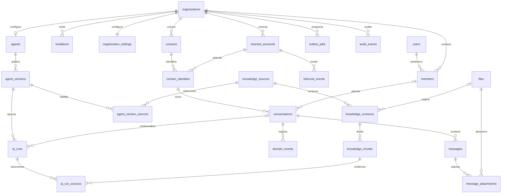

# Compathium — Diseño de base de datos del MVP

Fecha: 6 de septiembre de 2026. Estado: diseño propuesto, pendiente de implementación en Drizzle.

Base: [plan del MVP v1.2](MVP_PLAN.md). El documento maestro citado por el plan no está en este repositorio; este diseño todavía no se ha contrastado con él. Las decisiones cerradas del plan se mantienen. Las reglas de producto adicionales se identifican como propuestas.

## 1. Alcance y decisiones

PostgreSQL con pgvector; una base compartida y un solo nivel de tenant: `organization = workspace`. Better Auth administra identidad y membresía; Drizzle administra las migraciones. Redis transporta trabajo, Postgres conserva el estado recuperable.

Se diseña el MVP completo, pero las tablas se crean por fases. La primera implementación cubre identidad, canales, contactos, conversaciones, mensajes y eventos. Conocimiento e IA se incorporan en la fase 3.

No se incluyen campañas, billing, equipos dentro de un workspace, múltiples agentes ni un constructor de flujos. El ADR 0002 propone OpenAI y 1024 dimensiones; falta confirmarlos antes de crear `knowledge_chunks`.

Decisiones relacionadas: [ADR 0001 — Workspace](adr/0001_ORGANIZATION_IS_WORKSPACE.md) y [ADR 0002 — Proveedores de IA pendientes](adr/0002_AI_AND_EMBEDDING_PROVIDERS.md).

## 2. Convenciones e integridad

| Aspecto | Diseño |
|---|---|
| Nombres | Tablas plurales y columnas `snake_case`; propiedades TypeScript pueden usar `camelCase`. |
| Identificadores | PK `id uuid`; configurar generación UUID en Better Auth antes de generar su esquema. Las tablas de dominio usan UUID generados antes de encolar trabajo. |
| Tenant | `organization_id uuid NOT NULL` en toda tabla de negocio, con FK a `organizations.id`. En tablas 1:1 de configuración es también la PK. |
| Referencias | Padres de negocio con `UNIQUE (organization_id, id)`; hijos con FK compuesta `(organization_id, parent_id)`. Una FK a `id` por sí sola no garantiza pertenencia al mismo tenant. |
| Tiempo | `timestamptz`; almacenamiento como instantes, presentación según zona IANA del workspace. No usar la zona del servidor para «hoy». |
| Campos comunes | Tablas de dominio con `created_at NOT NULL DEFAULT now()`; tablas mutables también `updated_at`, actualizado explícitamente. Las excepciones de eventos se detallan más abajo. |
| Nulos | En el catálogo, `?` significa nullable; los demás campos son obligatorios salvo indicación explícita. |
| Estados | `text` + `CHECK` para estados de dominio; Better Auth conserva sus tipos y campos generados. |
| Importes | `numeric(18,8)` y moneda explícita; nunca `float`. Costo desconocido es `NULL`, no cero. |
| JSON | `jsonb` solo para configuración versionada, snapshots y payloads variables, validados por contratos. IDs que necesitan FK van en columnas. |
| Borrado | `RESTRICT` por defecto entre entidades de negocio. Archivar canales/contactos/fuentes/agente; conservar mensajes y versiones. |

PostgreSQL soporta claves foráneas compuestas y restricciones únicas; Drizzle permite declararlas junto con índices y checks. Las relaciones del ORM no sustituyen las restricciones físicas. [PostgreSQL: constraints](https://www.postgresql.org/docs/current/ddl-constraints.html), [Drizzle: indexes and constraints](https://orm.drizzle.team/docs/indexes-constraints).

Excepciones al tenant: `users`, `sessions`, `accounts` y `verifications` son globales de autenticación; `organizations` es la raíz. Un usuario puede ser miembro de varios workspaces. Los autores históricos apuntan a usuarios globales y se autorizan como miembros al escribir; no dependen de que su membresía siga existiendo.

### Aislamiento y autorización

- Los repositorios de negocio reciben un `TenantContext` verificado. Se filtran por `organization_id` también actualizaciones, borrados, joins, descargas, SSE y retrieval.
- `activeOrganizationId` selecciona el workspace; cada petición comprueba membresía vigente y permiso. El ID enviado por el navegador no concede acceso.
- Los jobs llevan tenant e IDs; el worker vuelve a comprobar pertenencia. Para webhooks/widget, el servidor resuelve tenant a partir de una cuenta de canal validada.
- Las FK compuestas evitan relaciones cruzadas, pero no bloquean un `SELECT` sin filtro. El MVP propone aislamiento de lectura en la aplicación con pruebas de dos tenants. RLS queda como defensa posterior y no se presume implementada.
- Roles de conexión: migraciones con DDL; procesos de aplicación sin DDL. Eventos y versiones publicadas tendrán permisos/restricciones específicos de inmutabilidad.

## 3. Diagrama principal

Las relaciones del diagrama omiten campos auxiliares; todas las entidades de negocio pertenecen a `organizations`.

## 4. Identidad y workspace — fase 1

El esquema de autenticación debe generarse con la versión fijada de Better Auth y el plugin `organization`, y después migrarse con Drizzle. Los nombres siguientes son el mapeo físico deseado, no un reemplazo manual de su esquema. Better Auth documenta generación de esquema para ORM y personalización de nombres. [Base de datos de Better Auth](https://better-auth.com/docs/concepts/database).

| Tabla | Contenido y restricciones relevantes |
|---|---|
| `users` | Identidad global: `id`, `name`, `email` único, `email_verified`, `image?`, timestamps. |
| `sessions` | `user_id`, token único, expiración, IP/user agent y `active_organization_id?` añadido por el plugin. Conservar campos/tipos generados. |
| `accounts` | Credenciales y cuentas OAuth de Better Auth. Distinta de `channel_accounts`; conservar campos de proveedor, tokens, password hash y expiraciones generados. |
| `verifications` | Verificaciones y expiraciones de Better Auth; conservar su esquema generado. |
| `organizations` | `id`, `name`, `slug` único, `logo?`, `metadata?`, `created_at`; una fila representa un workspace. |
| `members` | `id`, `organization_id`, `user_id`, `role`, `created_at`. Añadir/verificar `UNIQUE (organization_id, user_id)`. |
| `invitations` | `id`, `organization_id`, `email`, `role`, `status`, `inviter_id`, `expires_at` y campos generados por el plugin. Índice `(organization_id, status)`. |
| `organization_settings` | PK/FK `organization_id`; `timezone text` default `UTC`, `locale text` default `es`, `business_hours jsonb?`, timestamps. Horarios validados como intervalos locales semanales; excepciones por fecha dentro del mismo contrato. |

Mapeo de roles propuesto: `owner` → Owner, `admin` → Admin, `member` → Agente. Registrar permisos del producto en el access control de Better Auth; la membresía por sí sola no autoriza administración. Desactivar teams y roles múltiples para este corte. Los modelos de organización, miembro e invitación pertenecen al plugin. [Plugin organization](https://better-auth.com/docs/plugins/organization).

Owner/Admin administran configuración, conocimiento, agente y equipo. Agente puede atender el Inbox y consultar contactos; no administra equipo ni accede a facturación. Billing sigue fuera del MVP. La eliminación/degradación del último Owner se impide con operación serializada por workspace, incluyendo las rutas de Better Auth.

`UTC` es un fallback técnico del esquema, no una elección de producto. El plan exige una zona IANA explícita al crear el workspace; no habilitar horarios ni KPIs sin ella. No se infiere el país del piloto desde el entorno del desarrollador.

## 5. Canales y contactos — fases 1–2

Todas estas tablas incluyen PK `id`, tenant y timestamps comunes salvo `webchat_settings`, cuya PK es `channel_account_id`.

| Tabla | Campos específicos |
|---|---|
| `channel_accounts` | `type text` (`webchat`, `whatsapp`), `provider text` (`native`, `kapso`), `display_name text`, `status text` (`pending`, `connected`, `disconnected`, `error`), `provider_account_id text?`, `credentials_ref text?`, `archived_at timestamptz?`. |
| `webchat_settings` | `channel_account_id uuid`, `organization_id`, `public_key text` única global, `allowed_origins text[]`, timestamps. |
| `contacts` | `display_name text?`, `email text?`, `phone_e164 text?`, `notes text?`, `archived_at timestamptz?`. |
| `contact_identities` | `contact_id uuid`, `channel_account_id uuid`, `external_id text`, `metadata jsonb` default `{}`. |

Restricciones e índices:

- `CHECK` de combinaciones de canal/proveedor: `webchat/native` y `whatsapp/kapso` para el corte actual; cambiar adapter requiere ampliar esta restricción.
- `UNIQUE (provider, provider_account_id)` cuando `provider_account_id IS NOT NULL`; evita enrutar una misma cuenta externa a dos tenants. El adapter normaliza el ID si el proveedor usa un namespace adicional.
- Índice único parcial `channel_accounts (organization_id) WHERE type = 'whatsapp' AND archived_at IS NULL`: un número por workspace, incluyendo conexiones pendientes.
- `webchat_settings` referencia `(organization_id, channel_account_id)`; el servicio verifica que el tipo sea webchat.
- `UNIQUE (organization_id, channel_account_id, external_id)` en identidades. También `UNIQUE (organization_id, id, contact_id, channel_account_id)` para la FK de conversación.
- Índices `contacts (organization_id, created_at DESC, id)` e identidades `(organization_id, contact_id)`. Email/teléfono de contacto no son únicos: no fusionar personas automáticamente por datos declarados.
- FK de identidad a contacto y cuenta de canal dentro del mismo workspace.

La identidad externa de WhatsApp será el identificador normalizado del remitente. En webchat será un ID de visitante emitido por el servidor y vinculado a un token firmado con expiración y cuenta de canal. El token no se almacena en `external_id`; la clave pública del widget tampoco autentica al visitante. La renovación conserva la identidad solo tras verificar su token; un visitante sin token obtiene otra identidad.

Propuesta MVP: un contacto puede tener varias identidades; no se implementa todavía la fusión de contactos. `credentials_ref` apunta a un secreto del entorno/gestor de secretos, no contiene credenciales en texto plano. Los orígenes permitidos se comparan como orígenes exactos normalizados.

## 6. Conversaciones y mensajes — fases 1–2

### `conversations`

Además de PK, tenant y timestamps:

| Campo | Tipo / regla |
|---|---|
| `contact_id`, `contact_identity_id`, `channel_account_id` | `uuid`; FK conjunta a `(organization_id, id, contact_id, channel_account_id)` de identidad para impedir combinaciones inconsistentes. |
| `status` | `text`: `open`, `pending`, `resolved`; default `open`. `pending` significa espera de atención humana. |
| `assigned_to_user_id` | `uuid?`; FK `(organization_id, assigned_to_user_id)` a `members (organization_id, user_id)`. |
| `ai_paused` | `boolean` default `false`. |
| `handoff_reason` | `text?`: `no_evidence`, `intent`, `policy`, `schedule`, `manual`. Motivo actual; la historia vive en eventos. |
| `handoff_summary` | `text?`; resumen para atención humana. |
| `last_message_at` | `timestamptz?`; proyección del último mensaje externo ingresado/creado localmente, sin notas internas. |
| `last_customer_message_at` | `timestamptz?`; máximo timestamp válido del proveedor para entradas del cliente. |
| `resolved_at` | `timestamptz?`; presente si y solo si `status = 'resolved'`. |
| `automation_epoch` | `bigint` default `0`; cambia cuando una pausa, asignación, resolución o nueva entrada invalida respuestas de IA pendientes. |
| `event_sequence` | `bigint` default `0`; secuencia de eventos de esta conversación asignada bajo bloqueo de fila. |

Checks: `assigned_to_user_id IS NULL OR ai_paused`; motivo de handoff presente implica `ai_paused`; resolución implica IA pausada. Desasignar no reanuda IA. Reanudar es una acción explícita que exige desasignar, quitar el handoff actual, poner `open` e incrementar `automation_epoch`.

Propuesta de ciclo: como máximo una conversación no resuelta por identidad/cuenta. Una entrada después de resolver crea una nueva conversación; no se reabre el historial en el MVP. Una asignación o handoff lleva a `pending`; una respuesta humana mantiene `pending` hasta resolver o reanudar IA. No hay estados independientes para «atendida por IA» y «asignada».

Índices:

- Único parcial `(organization_id, contact_identity_id) WHERE status IN ('open', 'pending')`.
- `(organization_id, status, last_message_at DESC NULLS LAST, id)` para Inbox.
- `(organization_id, assigned_to_user_id, status, last_message_at DESC NULLS LAST, id)` para asignadas.
- `(organization_id, contact_id, created_at DESC, id)` para historial del contacto.

Antes de eliminar una membresía se desasignan sus conversaciones mediante el servicio de dominio, manteniendo la pausa y registrando eventos. La FK usa `RESTRICT`: una eliminación directa o una carrera se rechaza si sigue habiendo asignaciones. Los mensajes históricos conservan el autor aunque desaparezca la membresía.

### `messages`

Además de PK, tenant y timestamps:

| Campo | Tipo / regla |
|---|---|
| `conversation_id`, `channel_account_id` | `uuid`; FK conjunta a conversación `(organization_id, id, channel_account_id)`, con UNIQUE correspondiente en el padre. |
| `direction` | `text`: `inbound`, `outbound`, `internal`. |
| `sender_type` | `text`: `contact`, `human`, `ai`, `system`. |
| `author_user_id` | `uuid?` FK global a `users`; obligatorio solo para humano. |
| `body` | `text?`; puede faltar en mensaje con adjunto. |
| `content_type` | `text`: `text`, `image`, `audio`, `document`, `unsupported`. |
| `provider_message_id` | `text?`; requerido para entrada externa; nullable antes de confirmar salida. Webchat genera su ID de entrada antes del reintento. |
| `client_request_id` | `uuid?`; requerido para salida humana y nota interna, reutilizado por el cliente al reintentar. |
| `provider_timestamp` | `timestamptz?`; instante original, no se reemplaza por la fecha del reintento. |
| `ingested_at` | `timestamptz NOT NULL DEFAULT now()`; ingreso local. |
| `status` | `text`: `received`, `queued`, `sending`, `sent`, `delivered`, `failed`, `unknown`, `cancelled`, `recorded`. |
| `sent_at`, `delivered_at`, `failed_at` | `timestamptz?`; hitos de transporte. |
| `failure_code` | `text?`; código normalizado, sin secretos/payload crudo. |
| `correlation_id` | `uuid`; compartido por entrada → ejecución → respuesta → eventos/jobs. |

Reglas físicas: `inbound` solo `contact/received`; `internal` solo `human/recorded`; `outbound` solo `human/ai/system` con estados de envío. `author_user_id` existe si y solo si `sender_type = 'human'`. El servicio exige texto no vacío o al menos un adjunto y valida membresía del autor en esa transacción. Las notas internas no se envían, no aparecen en SSE del visitante y no cuentan como respuesta.

Índices: UNIQUE parcial `(organization_id, channel_account_id, provider_message_id)` si no es NULL; UNIQUE parcial `(organization_id, client_request_id)` si no es NULL; hilo `(organization_id, conversation_id, ingested_at, id)`. Colisiones de `client_request_id` con otro contenido devuelven conflicto, no éxito silencioso.

`queued → sending → sent → delivered`; `failed` representa fallo confirmado; `unknown`, un timeout con aceptación remota incierta. Reintentar fallo confirmado usa el mismo mensaje. Confirmaciones repetidas no crean eventos nuevos y `delivered` no retrocede ante un `sent` tardío. Guardar callbacks tempranos en `inbound_events` y reintentarlos si aún no se conoce el ID remoto.

### Archivos y adjuntos — fase 2

| Tabla | Campos específicos, además de PK, tenant y timestamps |
|---|---|
| `files` | `object_key text` única global, `original_name text`, `mime_type text`, `size_bytes bigint CHECK >= 0`, `sha256 text?`, `status text` (`pending`, `ready`, `failed`, `deleted`), `uploaded_by_user_id uuid?`, `deleted_at timestamptz?`. |
| `message_attachments` | `message_id uuid`, `file_id uuid`, `position integer CHECK >= 0`; UNIQUE `(organization_id, message_id, position)` y FK compuestas a mensaje/archivo. |

R2 conserva bytes; Postgres guarda metadatos y clave. URLs firmadas se generan tras autorización, no se persisten. Notas/adjuntos internos heredan visibilidad del mensaje. La subida y el commit SQL no son atómicos: archivos `pending` vencidos se limpian con job y solo `ready` puede ofrecerse como descarga.

## 7. Entrega fiable y eventos — fases 1–2

### `inbound_events`: recepción durable

PK y tenant; `channel_account_id uuid`, `provider_event_id text`, `event_type text`, `payload jsonb`, `correlation_id uuid`, `received_at timestamptz`, `processed_at timestamptz?`, `status text` (`pending`, `processing`, `processed`, `failed`), `attempts integer >= 0`, `available_at timestamptz`, `locked_until timestamptz?`, `lease_token uuid?`, `last_error text?`.

UNIQUE `(organization_id, channel_account_id, provider_event_id)` y FK compuesta a canal. Para Kapso se normaliza el ID de evento/clave de idempotencia; para webchat se usa un request ID estable. Un webhook puede contener varios mensajes: el registro deduplica el sobre y `messages` deduplica cada mensaje. Índice parcial `(available_at, id)` para pendientes/fallidos y otro `(locked_until, id)` para recuperar leases vencidos; son índices globales del dispatcher interno, no endpoints sin tenant.

Validar firma/credencial y resolver canal antes de persistir. Responder ACK solo tras guardar el evento de forma durable. Si Postgres falla, devolver error reintentable. La ingestión se confirma junto con sus efectos en una transacción; no marcar procesado antes de crear mensaje/eventos. Redis puede perder un job: un barrido vuelve a programar registros no procesados. Guardar solo el payload necesario y aplicar retención operativa configurable.

### `outbox_jobs`: trabajo tras un commit

PK, tenant y timestamps; `kind text` (`send_message`, `run_ai`, `ingest_knowledge`, `publish_event`), `dedupe_key text`, `payload jsonb` con IDs, `correlation_id uuid`, `status text` (`pending`, `processing`, `completed`, `failed`, `cancelled`), `attempts integer >= 0`, `available_at timestamptz`, `locked_until timestamptz?`, `lease_token uuid?`, `completed_at timestamptz?`, `last_error text?`.

UNIQUE `(organization_id, kind, dedupe_key)`. Índices de pendientes y leases equivalentes a `inbound_events`. El dispatcher reclama lotes con bloqueo y `SKIP LOCKED`; todas las confirmaciones verifican `lease_token`. El job se completa después del efecto, no al publicarlo en Redis. Payload validado y pertenencia de sus IDs comprobada por el handler. BullMQ es ejecutor; la outbox conserva la intención y permite reconstruir la cola.

Para salida, `dedupe_key = message_id`; esa misma clave interna se entrega al adapter como clave estable de idempotencia. Para una ejecución live automática, la clave deriva del mensaje de entrada. Generar un UUID nuevo en cada retry rompe la deduplicación.

**Límite externo:** una UNIQUE local no garantiza un único envío remoto tras un timeout. La integración debe verificar la capacidad/retención de idempotencia del proveedor. Si no existe garantía o expiró, un envío `unknown` se reconcilia por estado remoto o se revisa manualmente antes de reenviar. No se declara «exactly once» sobre la red.

### `domain_events`: historia para KPIs

Append-only. PK, tenant; `conversation_id uuid`, `sequence bigint > 0`, `type text`, `schema_version integer` default `1`, `message_id uuid?`, `ai_run_id uuid?` (fase 3), `actor_type text` (`contact`, `human`, `ai`, `system`), `actor_user_id uuid?`, `occurred_at timestamptz`, `recorded_at timestamptz DEFAULT now()`, `correlation_id uuid`, `dedupe_key text`, `payload jsonb` validado por tipo.

FK compuesta a conversación; si hay mensaje/run, FK que incluya además la conversación, con UNIQUE correspondiente en esos padres. UNIQUE `(organization_id, conversation_id, sequence)` y `(organization_id, dedupe_key)`. Índices `(organization_id, type, recorded_at, id)` y `(organization_id, conversation_id, sequence)`. El incremento de secuencia y el cambio de estado se confirman juntos bajo bloqueo de conversación. Las llegadas tardías no reescriben eventos previos.

Eventos mínimos del plan, más los necesarios para explicar sus métricas:

| Tipo | Información específica del payload |
|---|---|
| `conversation.created` | Canal, contacto, estado inicial. |
| `message.received` | Timestamp de cliente validado y tipo de contenido. |
| `message.sent`, `message.delivered`, `message.failed` | Mensaje, tipo de autor, timestamp remoto si existe y código normalizado de fallo. |
| `conversation.assigned` | Usuario anterior/nuevo (nullable para desasignar), estado y pausa resultantes. |
| `conversation.ai_paused`, `conversation.ai_resumed` | Motivo y estado resultante. |
| `conversation.resolved` | Actor que resuelve y timestamp; la clasificación IA se deriva de mensajes enviados. |
| `ai.run.completed` | Run, cobertura y resultado; solo live. |
| `ai.run.handed_off` | Run, motivo, resumen y estado resultante; solo live. |
| `conversation.handed_off` | Handoff manual sin run; misma información de derivación. |

Cada handoff emite **un** evento contable: `ai.run.handed_off` o `conversation.handed_off`. Repetir el mismo comando usa la misma dedupe key. Pausar/asignar después no genera otro handoff.

### `audit_events`: auditoría administrativa

Append-only. PK, tenant; `actor_user_id uuid?`, `action text`, `entity_type text`, `entity_id uuid?`, `before jsonb?`, `after jsonb?`, `correlation_id uuid`, `dedupe_key text`, `recorded_at timestamptz DEFAULT now()`.

UNIQUE `(organization_id, dedupe_key)`; índice `(organization_id, recorded_at DESC, id)`. Incluye cambios de roles, configuración de canal, publicación/rollback y archivo. El objetivo polimórfico es una referencia histórica validada al escribir, no una FK universal. Excluir contraseñas, tokens y contenido innecesario. No reemplaza los eventos de conversaciones ni se usa para KPIs.

Sin `updated_at` en ambas tablas de eventos. Negar UPDATE/DELETE al rol de aplicación; las correcciones se añaden como eventos nuevos. Las purgas por retención se ejecutan con un rol de mantenimiento separado.

## 8. Conocimiento — fase 3

Tablas con PK, tenant y timestamps comunes salvo revisiones/chunks, que solo tienen `created_at`.

| Tabla | Campos específicos |
|---|---|
| `knowledge_sources` | `kind text` (`faq`, `document`), `title text`, `draft_content jsonb` (pregunta/respuesta o referencia de archivo validada), `published_revision_id uuid?`, `archived_at timestamptz?`. |
| `knowledge_revisions` | `source_id uuid`, `version integer > 0`, `title text`, `question text?`, `answer text?`, `file_id uuid?`, `content_hash text`, `created_by_user_id uuid`, `published_at timestamptz?`, `index_status text` (`pending`, `processing`, `ready`, `failed`), `index_error text?`, `embedding_model text`, `dimensions integer > 0`. |
| `knowledge_chunks` | `revision_id uuid`, `position integer >= 0`, `content text`, `page_number integer? CHECK > 0`, `token_count integer? CHECK >= 0`, `embedding_model text`, `dimensions integer`, `embedding vector(N)`. |

FK compuestas a fuente, revisión y archivo; UNIQUE `(organization_id, source_id, version)` y `(organization_id, revision_id, position)`. El puntero publicado referencia `(organization_id, source_id, id)` de revisiones mediante `(organization_id, id, published_revision_id)` de fuente. Garantiza que la revisión pertenece a esa fuente.

Una revisión es FAQ con pregunta/respuesta y sin archivo, o documento con archivo y sin pregunta/respuesta. Verificar que coincida con `source.kind` dentro del servicio transaccional; un CHECK local no consulta otra tabla. Los IDs de archivos dentro del draft se validan en cada operación; al crear la revisión pasan a FK real.

La publicación crea una revisión de contenido inmutable y un job de ingestión en la misma transacción. Al completar todos los chunks, se cambia `index_status` a `ready` y se actualiza el puntero publicado atómicamente; si falla, sigue vigente la revisión anterior. Serializar publicaciones por fuente; el job atrasado no puede reemplazar una revisión más nueva. Los chunks de una revisión ready no se sobrescriben. Los campos operativos de indexación sí pueden actualizarse durante el procesamiento.

FAQs también generan chunks: no tienen un retrieval separado. Un draft no es recuperable. Archivar una fuente la excluye de nuevas consultas, pero conserva revisiones/chunks citados por runs históricos.

### Vectores sin cerrar D-2 prematuramente

La migración base habilita `vector`; `knowledge_chunks` se crea solo tras confirmar `N`, proveedor/modelo exacto y estrategia de distancia en el ADR 0002. El plan v1.2 propone por defecto OpenAI `text-embedding-3-small` con `N = 1024` y coseno, pendiente de veto del founder antes de la fase 3. Cada chunk conserva `embedding_model` (identificador con proveedor) y `dimensions`; CHECK `dimensions = N` y `vector_dims(embedding) = dimensions`. FK adicional a revisión que incluya modelo/dimensión, con UNIQUE equivalente en el padre, para evitar metadatos incompatibles.

Propuesta inicial: distancia coseno, búsqueda exacta sobre los chunks publicados y autorizados del tenant; medir antes de añadir HNSW. Si se usa HNSW, `vector_cosine_ops`, con filtros de tenant/fuentes y pruebas de recall. pgvector documenta que los filtros pueden reducir resultados en índices aproximados y ofrece escaneos iterativos. El límite de HNSW para `vector` es 2.000 dimensiones; ≤1.536 en el plan es una preferencia, no ese límite técnico. [pgvector: índices y filtrado](https://github.com/pgvector/pgvector).

Cambiar modelo, aunque conserve dimensión, obliga a reindexar. Para el MVP se propone una migración de corpus con pausa temporal de IA y activación completa del nuevo índice; no mezclar embeddings de modelos distintos en una consulta. Un cambio de dimensión también requiere cambiar la columna/índice. El proveedor del embedding de la consulta debe coincidir con el corpus activo.

## 9. Agente, ejecuciones y simulador — fase 3

| Tabla | Campos específicos, además de PK, tenant y `created_at` |
|---|---|
| `agents` | `name text`, `draft_config jsonb`, `published_version_id uuid?`, `archived_at timestamptz?`, `updated_at`. UNIQUE `(organization_id)`: un agente por workspace. |
| `agent_versions` | `agent_id uuid`, `version integer > 0`, `config jsonb`, `published_by_user_id uuid`, `published_at timestamptz`. UNIQUE `(organization_id, agent_id, version)`. |
| `agent_version_sources` | `agent_version_id uuid`, `source_id uuid`; UNIQUE `(organization_id, agent_version_id, source_id)`. |
| `ai_runs` | `mode text` (`live`, `simulation`), `agent_version_id uuid?`, `draft_config_snapshot jsonb?`, `conversation_id uuid?`, `trigger_message_id uuid?`, `response_message_id uuid?`, `requested_by_user_id uuid?`, `request_key text`, `automation_epoch bigint?`, `status text` (`queued`, `running`, `completed`, `handed_off`, `failed`, `cancelled`), `input_snapshot jsonb`, `output_text text?`, `evidence_coverage text?` (`none`, `partial`, `strong`), `handoff_reason text?`, `handoff_summary text?`, `chat_provider text?`, `chat_model text?`, `embedding_model text?`, `started_at timestamptz?`, `finished_at timestamptz?`, `latency_ms integer? CHECK >= 0`, `input_tokens integer? CHECK >= 0`, `output_tokens integer? CHECK >= 0`, `cost numeric(18,8)? CHECK >= 0`, `cost_currency text?`, `error_code text?`, `correlation_id uuid`, `updated_at`. |
| `ai_run_sources` | `ai_run_id uuid`, `chunk_id uuid`, `rank integer > 0`, `retrieval_score double precision`, `cited boolean`, `title_snapshot text`, `excerpt_snapshot text`. UNIQUE `(organization_id, ai_run_id, chunk_id)` y `(organization_id, ai_run_id, rank)`. |

Todas las referencias de dominio son FK compuestas. `agents.published_version_id` referencia una versión del **mismo agente**, con UNIQUE/FK que incluyan `agent_id`. Publicar copia configuración y vínculos de fuentes bajo bloqueo del agente; quedan inmutables. Rollback cambia el puntero a una versión previa y genera auditoría; no modifica la versión ni los runs existentes.

`config` contiene objetivo, tono, idioma, instrucciones, proveedor/modelo de chat, reglas de intención/política, umbral y parámetros de retrieval, y comportamiento de horario. Contrato versionado con `schema_version`; horarios concretos viven en configuración del workspace y se copian al snapshot del run. Orden de reglas: intención/política → evidencia → horario/disponibilidad.

Propuesta: las versiones del agente fijan **qué fuentes** están habilitadas y usan la revisión publicada vigente de cada fuente. Actualizar una FAQ no obliga a publicar el agente. Rollback del agente no revierte el conocimiento. `input_snapshot` guarda revisiones consultadas, historial de entrada, configuración efectiva y horario; `ai_run_sources` conserva los chunks evaluados y cuáles se citaron.

Restricciones de ejecución:

- Live: versión publicada, conversación, mensaje de entrada y epoch obligatorios; snapshot de draft y solicitante de simulación nulos. FK del trigger/respuesta incluye conversación; validar dirección de ambos mensajes en el servicio.
- Simulation: conversación, trigger, respuesta y epoch nulos; solicitante obligatorio; exactamente una de versión publicada o snapshot de draft. Un draft incluye su selección de fuentes validada. Nunca se inserta un `messages.outbound`, job de envío ni evento KPI por simulación.
- UNIQUE `(organization_id, mode, request_key)` y UNIQUE parcial `(organization_id, trigger_message_id) WHERE mode = 'live'`: una ejecución automática lógica por entrada en el MVP. Retry retoma ese run; un nuevo experimento de simulador usa otra key.
- `response_message_id` es único cuando existe: como máximo una respuesta por run. La creación del mensaje y la referencia del run se hacen juntas. Índice `(organization_id, conversation_id, created_at DESC)` y `(organization_id, status, created_at)`.
- `evidence_coverage` puede ser NULL mientras no se haya evaluado evidencia, o si la intención/política corta antes del retrieval. Un run `completed` exige cobertura `partial` o `strong`, texto de salida y ningún motivo de handoff. En live exige además respuesta asociada.
- Cobertura `none` implica handoff `no_evidence` si el run termina normalmente; no se genera respuesta. `handed_off` exige motivo/resumen, sin respuesta. Una respuesta generada no significa entrega: el estado de transporte vive en `messages`.
- Costos son del run lógico, acumulados incluyendo intentos cobrados cuando el proveedor los informa; NULL si el costo total no puede determinarse. La moneda acompaña cualquier importe presente.
- No hay campo `confidence`. `retrieval_score` es similitud de recuperación, no una confianza autoreportada ni un porcentaje mostrado al usuario.

## 10. Transacciones y carreras que la implementación debe resolver

1. **Entrada duplicada/concurrente:** reclamar evento con lease; obtener/crear identidad con su UNIQUE; bloquear identidad para elegir/crear conversación activa; insertar mensaje con deduplicación; actualizar timestamps mediante máximos e incrementar epoch; escribir eventos y outbox de IA/SSE; marcar entrada procesada; commit. Si otra transacción gana la creación de identidad, revertir también el contacto provisional antes de reutilizar la identidad existente. Un duplicado no actualiza contadores ni dispara otro run. El job de IA captura el epoch y la versión publicada en esta transacción.
2. **Respuesta humana:** validar permiso y request key; bloquear conversación; pausar IA e incrementar epoch; crear mensaje queued y outbox de envío; commit. Si está resuelta, rechazar el envío en este corte. Una nota interna no genera salida.
3. **IA en vuelo:** usar el epoch y la versión capturados al programar la ejecución, sin reemplazarlos por los valores actuales cuando arranque el worker. Al iniciar, persistir respuesta y autorizar despacho, bloquear conversación y exigir mismo epoch, estado abierto y `ai_paused = false`. Si cambió, cancelar run/mensaje/jobs todavía no despachados. Así, dos entradas seguidas dejan elegible solo la ejecución más reciente, cuyo historial incluye ambas entradas. Nunca mantener una transacción abierta durante la llamada al modelo.
4. **Pausa contra envío:** pausa/asignación y autorización de despacho comparten el bloqueo de conversación. El orden de commit define qué ganó. Una pausa cancela lo que aún no se autorizó; un envío ya autorizado/en curso puede llegar después y no se puede retirar de la red. Mostrar ese estado en Inbox y verificarlo con una prueba de carrera.
5. **Callback de entrega:** deduplicar evento, bloquear mensaje, aplicar transición válida y emitir el hito una sola vez en la misma transacción. Si llega `delivered` antes que `sent`, registrar también el hito sent faltante con timestamp conocido o fallback local explícito; un fallo tardío no degrada una entrega confirmada.
6. **Resolver:** bloquear conversación; cambiar estado/fecha y pausar IA; incrementar epoch; insertar `conversation.resolved` y outbox de publicación; commit. Resolver dos veces no duplica el evento.
7. **Publicar conocimiento/agente:** cambios, vínculos y auditoría son atómicos. El trabajo remoto de R2/embeddings queda fuera de la transacción y usa IDs estables para reintentos.

Usar un orden de bloqueos consistente —identidad si hace falta, conversación, mensaje/run— para reducir deadlocks; reintentar conflictos transitorios con las mismas claves. Leases vencidos permiten recuperar trabajo; un proceso con token antiguo no puede confirmar resultados locales.

## 11. Seis KPIs a partir de eventos — fase 5

Definiciones propuestas para quitar ambigüedad al plan. «Hoy» es `[inicio del día local, inicio del siguiente día local)` convertido a instantes UTC. Los filtros temporales operativos usan `recorded_at`; `occurred_at` conserva el hecho externo para análisis de retrasos. Cada consulta recibe tenant.

| KPI | Definición y filtro del Inbox |
|---|---|
| Conversaciones hoy | Conteo de `conversation.created` registrado hoy. Abre esos IDs. |
| Activas | Conversaciones cuyo último evento de estado por secuencia deja `open` o `pending` al momento de consulta, sin limitarse a creadas hoy. Abre esos IDs. |
| Resueltas | Conversaciones con `conversation.resolved` registrado hoy. Como no hay reapertura, solo hay una resolución por conversación. Abre esos IDs. |
| Resolución IA | Porcentaje sobre resueltas hoy: al menos un `message.sent` de IA y ningún `message.sent` humano en toda la conversación. Una nota interna no cuenta. Sin denominador, mostrar «—». Abre los IDs del numerador. |
| Primera respuesta | Mediana, en segundos, para conversaciones creadas hoy que ya tienen primera respuesta externa enviada (humano o IA). Diferencia entre `recorded_at` del primer `message.received` y primer `message.sent`; sin respuesta se excluyen y se informa tamaño de muestra. Abre la cohorte usada. |
| Handoffs | Número de eventos `ai.run.handed_off` + `conversation.handed_off` registrados hoy; una nueva derivación tras reanudar sí cuenta. Abre IDs distintos de esas conversaciones. |

Resolución IA sigue la definición del plan basada en ausencia de mensaje humano; no equivale a «sin intervención humana». Incluye el caso donde una persona solo marca resolver. Un envío humano confirmado tarde puede reclasificar el indicador, ya que se evalúa toda la conversación conocida. Si se desea medir autonomía completa, es otra definición por aprobar.

El cálculo no usa `conversations.status` como historia: esa columna es una proyección para operar el Inbox. La mediana propuesta mide latencia observada por la plataforma, incluyendo confirmación del envío; no pretende medir entrega ni restar relojes no confiables del cliente. En piloto, consultar eventos directamente; agregar proyecciones materializadas solo cuando las mediciones lo justifiquen.

## 12. Orden de migraciones

| Orden lógico | Contenido | Dependencia |
|---|---|---|
| 0000 | `CREATE EXTENSION IF NOT EXISTS vector`; auth generado y configuración del workspace. | Scaffold, versión de Better Auth fijada y ADR 0001. ADR 0002 documenta diferimiento. |
| 0001 | Canales, contactos/identidades, conversaciones, mensajes, recepción durable, outbox, eventos de dominio y auditoría. | Convenciones y contratos de mensajes/eventos. |
| 0002 | Configuración webchat, archivos y adjuntos. | Widget/Inbox, R2. |
| 0003 | Fuentes, revisiones, chunks e índices vectoriales si corresponden. | **D-2 confirmado** (default: `text-embedding-3-small`, N = 1024, coseno; veto antes de fase 3). |
| 0004 | Agente, versiones, fuentes habilitadas, runs, evidencias; FK de run en eventos. | D-1 confirmado (default: OpenAI) y conocimiento disponible. |
| 0005 | Ajustes que exija el adapter Kapso, índices de callbacks y validaciones de ventana. | D-6 pendiente; verificar capacidades reales del proveedor. D-8 cerrado por defecto: bloquear fuera de ventana. |

Los números describen dependencias, no archivos ya generados. Punteros circulares (fuente/revisión y agente/versión) se crean nullable y sus FK se añaden después de ambas tablas. FK de eventos a runs se añade en fase 3. La extensión se habilita antes de cualquier columna vectorial. No ejecutar estas migraciones ni provisionar infraestructura como parte de este documento.

Para WhatsApp, la ventana se calcula con `last_customer_message_at` validado y el reloj del servidor. El adapter valida timestamps futuros y vuelve a revisar elegibilidad justo antes del envío; la ingestión tardía no renueva la ventana artificialmente. D-8 cerrado por defecto en el plan v1.2: fuera de ventana se bloquea el envío libre y se avisa; no se modelan plantillas aprobadas en el MVP.

## 13. Borrado, retención y validación antes del piloto

Archivar no elimina contenido ni deshace referencias. Quitar una membresía no borra al usuario ni sus mensajes. La eliminación de usuarios/workspaces no se expone como cascada masiva; requiere un proceso explícito de anonimización/purga que respete referencias y archivos R2. Conservar autor global bajo `RESTRICT` hasta ese proceso.

Antes del piloto hay que fijar plazos de retención para payloads entrantes, runs/snapshots, mensajes, auditoría y archivos. Deduplicación de mensajes enviados debe sobrevivir al horizonte de retry; no purgar claves de outbox mientras un mensaje sea reenviable. Las fuentes/revisiones citadas se conservan mientras existan sus runs. La información sensible no se copia indiscriminadamente a eventos o logs.

Pruebas de integración requeridas al implementar, sobre Postgres real con pgvector:

- Dos tenants: lecturas/escrituras, descarga, SSE y retrieval aislados; FK rechaza identidad, conversación, mensaje, archivo o fuente de otro tenant.
- Better Auth: crear workspace, invitar/aceptar, cambiar workspace, permisos del Agente, proteger último Owner y retirar miembro asignado sin perder historial.
- Entradas concurrentes/repetidas: un contacto/identidad, una conversación activa, un mensaje, un evento y una ejecución lógica.
- Salida repetida, crash antes/después de aceptación remota, callbacks fuera de orden, job perdido en Redis y recuperación de lease sin doble efecto.
- Pausa/asignación/resolución durante generación y durante despacho: ninguna respuesta nueva pasa la autorización con epoch obsoleto.
- Nota interna invisible al visitante; simulación de draft y publicada sin mensajes, envíos ni KPIs reales.
- FAQ draft excluida, publicación fallida conserva revisión previa, retrieval sin evidencia deriva, fuentes de otro tenant nunca aparecen y rollback conserva versiones.
- Modelo/dimensión incorrectos rechazados; resultados de retrieval comprobados con filtros de tenant y corpus realista.
- Fixtures de eventos para los seis KPIs: día local, conversación sin respuesta, nota interna, doble callback, handoff repetido y envío humano confirmado tarde.

Las [preguntas abiertas](OPEN_QUESTIONS.md) registran las decisiones nuevas a revisar con producto: no reabrir conversaciones resueltas, `pending` como atención humana, un run automático por entrada, fuentes publicadas vigentes al ejecutar y las definiciones temporales de KPIs. Ninguna bloquea redactar el modelo; deben mantenerse explícitas al implementar.
